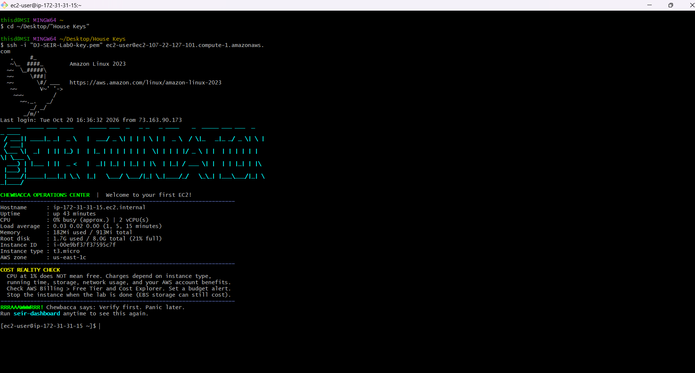
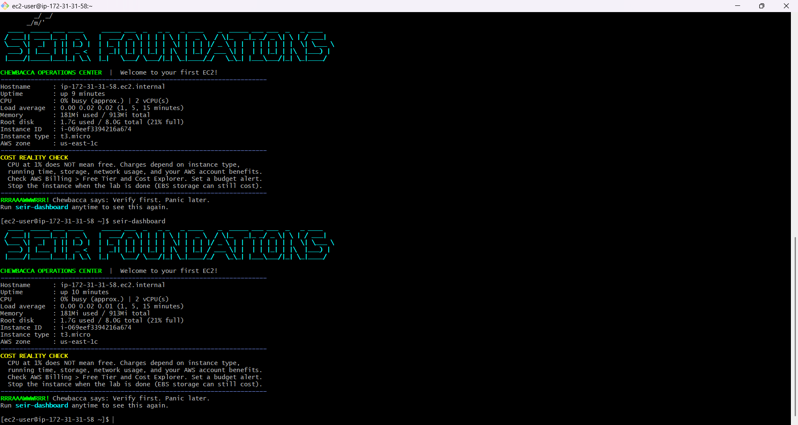
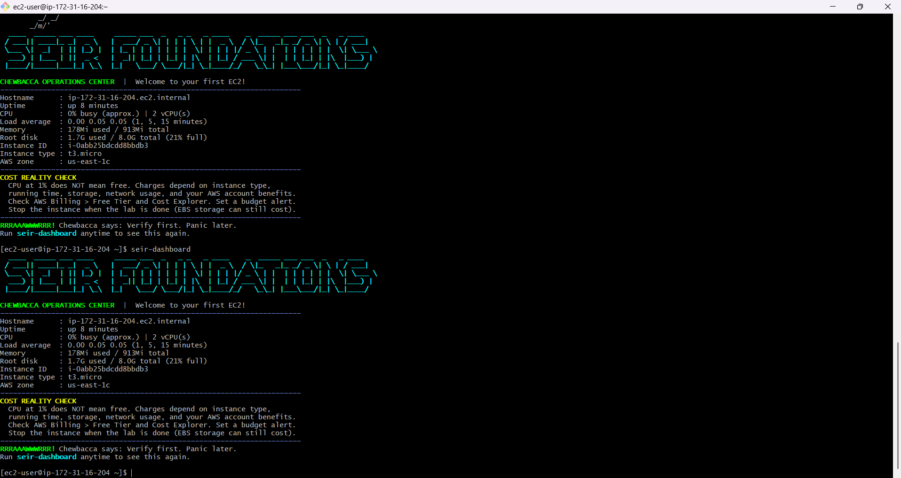
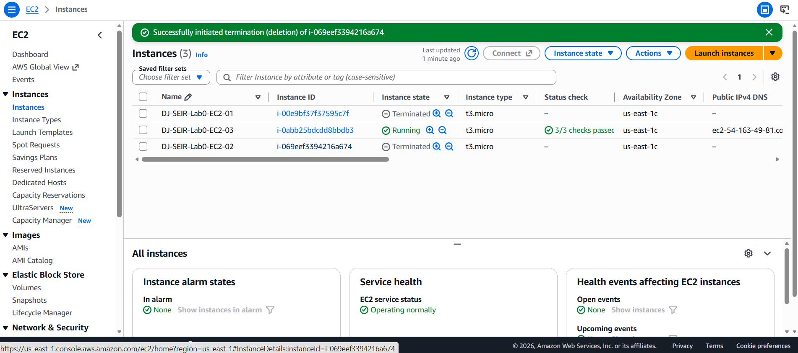
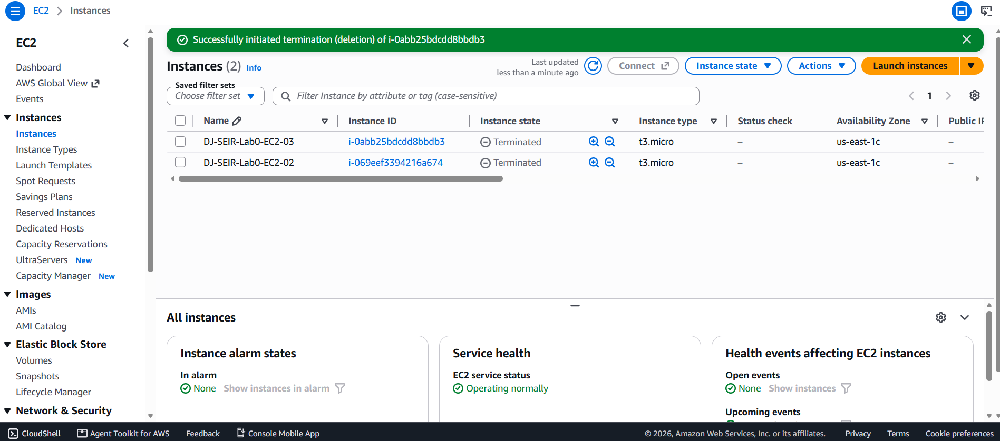

# SEIR Foundations — Module 1 / Lab 0: EC2 Basics

**Student:** DJ  
**Date:** October 20, 2026  
**AWS Region:** us-east-1 (N. Virginia)  
**AMI:** Amazon Linux 2023  
**Instance type:** t3.micro  
**Connection:** SSH from Windows Git Bash as `ec2-user` using a private `.pem` key stored locally  
**Network:** Default VPC; dedicated lab security group with SSH (TCP 22) and HTTP (TCP 80) restricted to a trusted `/32` source  
**Storage:** 8 GiB root EBS volume per instance

## Objective

Practice launching three separate EC2 instances, identifying their public IPv4 addresses, connecting by SSH, checking the SEIR dashboard, documenting results, and terminating the instances. Deployments were performed **sequentially**, not concurrently.

## Deployment evidence

| Deployment | Instance ID | Public IPv4 | Connection method | Screenshot | Terminated? |
|---|---|---|---|---|---|
| 1 | `i-00e9bf37f37595c7f` | `107.22.127.101` | SSH / Git Bash | [Deployment 1](screenshots/deployment-1.png) | Yes |
| 2 | `i-069eef3394216a674` | `18.207.156.178` | SSH / Git Bash | [Deployment 2](screenshots/deployment-2.png) | Yes |
| 3 | `i-0abb25bdcdd8bbdb3` | `54.163.49.81` | SSH / Git Bash | [Deployment 3](screenshots/deployment-3.png) | Yes |

All three instances had **different public IPv4 addresses**. The displayed dashboard instance IDs matched the AWS Console instance IDs.

## Deployment 1 — Initial launch and troubleshooting

I launched an Amazon Linux 2023 `t3.micro` instance in `us-east-1c`, checked its AWS running/status-check state, and identified its public IPv4 address. My initial SSH attempt from Windows failed with **`WARNING: UNPROTECTED PRIVATE KEY FILE!`** because the private key's Windows file permissions were too permissive. I corrected the key file's ACLs using Windows `icacls` to remove inherited access and grant my Windows user read access. I then connected successfully from Git Bash as `ec2-user`, viewed the automatic SEIR dashboard, and captured evidence. Afterward I terminated the instance.

## Deployment 2 — Repeat with existing resources

I launched a new Amazon Linux 2023 `t3.micro` instance, reusing the corrected SSH key pair and dedicated lab security group. I recorded the new public IPv4 address, connected from Git Bash, and ran `seir-dashboard` to confirm the instance identity and view its system information. I saved the terminal and AWS evidence, then terminated the instance.

## Deployment 3 — Independent repetition

I launched a third Amazon Linux 2023 `t3.micro` instance using the same key pair, security group, and 8 GiB root volume. The AWS Console showed the instance running and passing **3/3 status checks**. I connected by SSH to `54.163.49.81`, confirmed that the dashboard displayed instance ID `i-0abb25bdcdd8bbdb3`, and manually ran `seir-dashboard` again. I captured screenshots and terminated the instance at approximately **14:12 local time**.

## What the dashboard taught me

- **CPU:** Indicates current processor activity; a low CPU percentage does not mean an instance is free of charge.
- **Memory:** Shows RAM used versus available, helping identify resource pressure.
- **Root disk:** Shows used versus total filesystem capacity, useful for detecting storage exhaustion.
- **Uptime:** Shows how long the Linux instance has been running since boot.
- **Instance ID / type / Availability Zone:** Allows me to verify that the Linux session corresponds to the intended AWS instance.

## What became easier with repetition

The first deployment required diagnosing an SSH permissions problem. By the second and third deployments, locating the public IPv4 address, reusing the existing key and security group, connecting with `ssh -i`, and verifying the dashboard had become a repeatable sequence. I also learned to distinguish **instance termination initiated** from **instance state actually showing Terminated**, and that terminated instances eventually disappear from the EC2 list.

## Cleanup evidence

All three practice instances were confirmed terminated in the AWS Console. AWS showed instances 01 and 02 terminated together, and later instances 02 and 03 terminated together; instance 01 had already disappeared from the console's retained instance list.

**Resource note:** Terminating an EC2 instance commonly deletes its root EBS volume when *Delete on termination* is enabled. Other resources, such as independent EBS volumes, EFS, S3, or Elastic IP allocations, have separate lifecycles and should be checked for leftover charges. I did not configure EFS or S3 for these launches.

## Launch-template note

The class instructions specify creating, saving, and reusing an **EC2 launch template**. For these three repetitions I used the EC2 **Launch instance** workflow and manually reused the same configuration, key pair, security group, and User Data. **I did not verify that a saved launch template exists.** This is an outstanding item against the instructor's prescribed workflow, not a claim of completion.

## Additional dashboard screenshots

- [Dashboard 1](screenshots/dashboard-1.png)
- [Dashboard 2](screenshots/dashboard-2.png)
- [Dashboard 3](screenshots/dashboard-3.png)

## Security and evidence handling

The private SSH `.pem` key and any AWS credentials remain local and are **not included** in this repository. Screenshots should be checked for account-identifying information before publication. Public IPv4 addresses are included as required by the assignment; they are historical addresses and no longer assigned to these terminated instances.

**Source:** [SEIR Foundations Lab 0 instructions](https://github.com/BalericaAI/SEIR-Foundations/tree/main/module1/lab0_basics)
